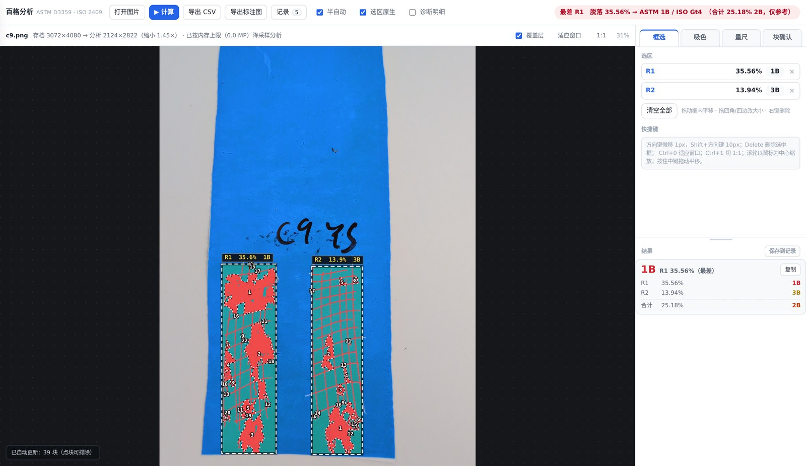
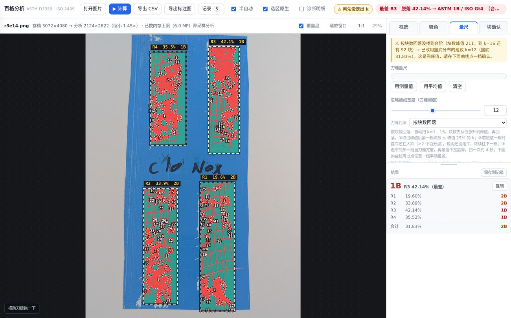
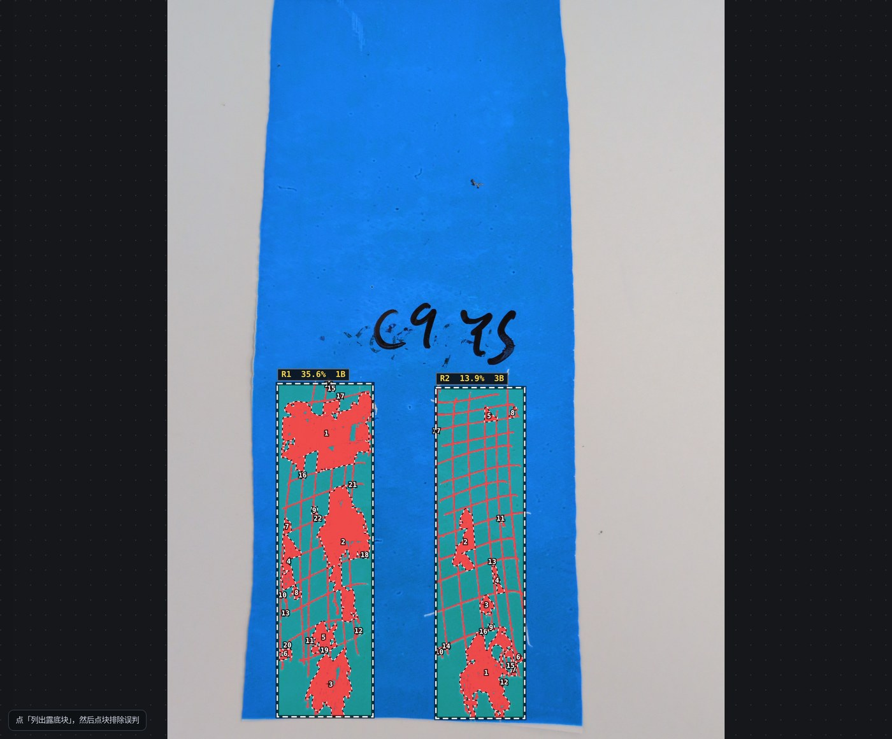
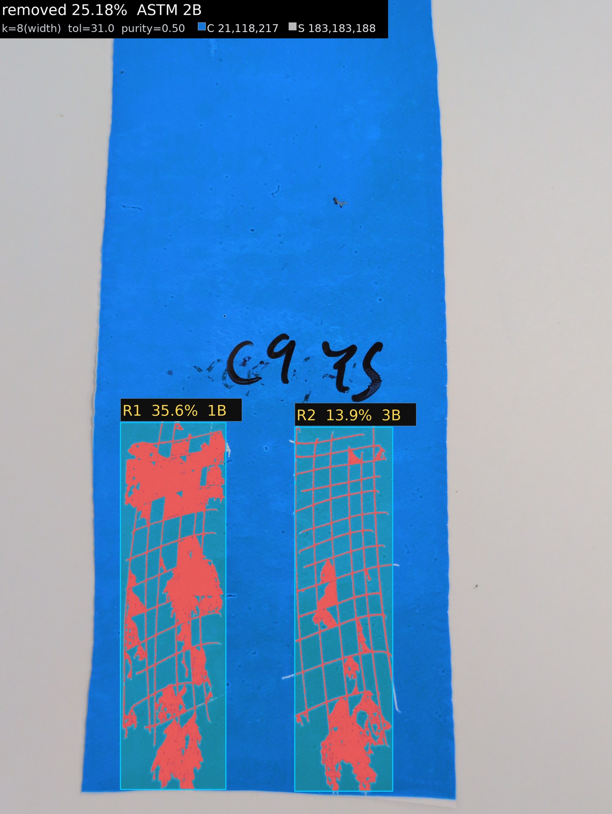

# Baige — Cross-Cut Adhesion Analyzer

A web tool that turns cross-cut (cross-hatch) adhesion tests from eyeball comparison into reproducible numbers, following **ASTM D3359 Method B / ISO 2409 / GB/T 9286**.

*Developed with the DeepSeek API* — see the badge in the app's top bar.

Frame each cross-hatched area, pick two reference colours (intact coating / exposed substrate), and the tool removes the lattice cuts, measures how much coating actually came off, and reports per-region percentages with ASTM / ISO grades.



*Multi-region analysis. Each ROI reports its own percentage and grade; the headline grade follows ASTM — the worst region wins, the area-weighted total is for reference only.*

---

## Why

Manual grading is comparison against printed reference pictures. Two people reading the same sample routinely disagree by one grade, and "how much came off" is never a number you can re-check later.

This tool reduces it to an area ratio you can recompute from the same photo at any time:

```
removed % = exposed-substrate pixels after groove removal
            ──────────────────────────────────────────────
            intact-coating pixels + raw exposed-substrate pixels
```

The numerator drops the lattice cuts (a cut is bare substrate, but it is not coating loss). The denominator uses the *raw* exposed area, so removing grooves never moves the baseline.

## Features

- **Multiple ROIs** — one per cross-hatch area; the conclusion follows the worst region, per ASTM
- **CIELab colour calibration** — nearest-reference classification, with tolerance (unclassified) and purity (transition band) as separate controls
- **Groove threshold `k`** — two independent rules, plus a full `k=1…16` curve you can read and click
- **Per-block review** — every exposed-substrate blob listed by connected component; click to exclude a mis-detected cut and results recompute instantly
- **Ruler** — measure across a cut; the measured full width becomes the threshold
- **Diagnostics** — grading margin, exposure-thickness histogram, tolerance sensitivity, colour-distance distribution
- **Records** — parameters and results saved; reopen later and get identical numbers
- **Export** — CSV detail and an annotated result image
- **Semi-automatic** — auto-picks colours and threshold once framing is done, still human-confirmable

## How a measurement is made

1. **Upload** — the original is kept; analysis runs on a copy capped at 6 MP, or on native pixels inside the ROIs when *native ROI* is enabled.
2. **Calibrate** — pick intact coating and exposed substrate; pixels go to CIELab and are assigned to the nearest reference. Distance beyond *tolerance* → **unclassified** (counted on neither side); mixed pixels inside the *purity* band → **transition**.
3. **Remove grooves** — a `k×k` morphological opening: structures thinner than `k` disappear, blobs thicker than `k` survive.
4. **Measure** — the ratio above, per ROI, then an area-weighted total.
5. **Grade** — ASTM / ISO lookup; the reported grade is the worst ROI.

## Two ways to choose the groove threshold `k`



**By block count (default).** After grooves are removed correctly, what remains should be a few large flakes. Too small a `k` leaves the lattice connected and shreds the mask into hundreds of fragments, so the block count rises to a peak and then collapses; the collapse point is the cut width. The rule takes the first level at ≤25 % of the peak, then keeps walking while the removal percentage still drops ≥2 pp per level — stopping where the curve flattens.

**By exposure-thickness distribution.** Thickness is measured by successive erosion (≈2× inscribed radius) and binned at 1-3 / 4-6 / 7-10 / 11-16 / ≥17 px. Cuts are thin, flakes are thick; when structures ≤10 px dominate the exposed area, the 75th percentile of that thin population + 2 becomes the starting threshold. That is a starting point only — it can be overridden at any time.

**When neither rule has an answer** (continuous thickness, no step), the tool falls back to the thickness suggestion, refuses it if it would erase real loss (≤5 % of the original left), and shows a persistent warning with the peak, the last level and the value in use — so a silent number never crosses a grade boundary unnoticed.

## Per-block review



Connected components of the surviving mask are numbered (8-connectivity, min area 30 px, max 240 blocks). Mis-detected cut segments can be excluded one at a time; percentages, grade and the saved record all follow.

## Export



The annotated image carries the conclusion plus every parameter needed to reproduce it (`k`, tolerance, purity) and the reference colour swatches.

## Grading

| Removed area | ASTM | ISO / GB |
|---|---|---|
| ≤ 0.5 % (treated as 0) | 5B | Gt0 |
| > 0.5 % and < 5 % | 4B | Gt1 |
| 5 – 15 % | 3B | Gt2 |
| 15 – 35 % | 2B | Gt3 |
| 35 – 65 % | 1B | Gt4 |
| > 65 % | 0B | Gt5 |

## Run it (no command line needed)

**Windows** — double-click `start.bat`.
**Linux** — double-click `start.sh` (if the file manager opens it in an editor instead: right-click → *Allow executing file as program*), or run `./start.sh`.
**macOS** — double-click `start.command`.

The launcher creates a local virtual environment under `.venv`, installs the dependencies (first run: 1–3 minutes, falls back to a mirror if PyPI is unreachable), starts the server on `127.0.0.1:8765` (next free port if taken) and opens your browser. Closing the window stops it. All data stays in the `data/` folder next to the code.

Requirements: Python 3.9+ (Windows installer: tick *Add python.exe to PATH*; Debian/Ubuntu: `sudo apt install python3 python3-venv`). Tkinter is **not** needed — the desktop GUI is optional.

Manual start, if you prefer:

```bash
python3 -m venv venv && ./venv/bin/pip install -r requirements.txt
./venv/bin/uvicorn server:app --host 127.0.0.1 --port 8765
```

The server binds loopback only and has no login of its own — it is meant to be published behind a reverse proxy / SSO if you need remote access.

## Layout

```
server.py      FastAPI service: upload, analysis, threshold rules, records, export
crosscut.py    imaging core: colour classification, opening, thickness, components, grading
static/        front-end (plain HTML + JS, no build step)
launcher.py    one-click launcher (venv + deps + server + browser)
start.bat      Windows double-click entry point
start.sh       Linux double-click entry point (start.command for macOS)
docs/          screenshots and technical notes
data/          runtime data (upload sessions, overlays, records) — created on first run, not committed
releases/      deployment snapshots for rollback — not committed
```

## Known limits

- A morphological opening judges thickness, not shape: a thin but *wide* flake gets removed along with the cuts.
- When cut width and flake width are continuous (no step in the curve), no automatic rule can decide; the tool gives a fallback value plus a prominent warning and leaves the call to the operator.
- Colour calibration sets the floor: white balance, glare and shadows split one material into two hues. Watch the tolerance-sensitivity line.
- Area-weighted totals are not ASTM conclusions — use the worst region.
- Lattices cut by hand with a single blade are not a compliant specimen per the standards; results are valid for relative comparison only.

## Docs

`docs/technical-notes-v2.02.pdf` — installation (including the one-click launcher), full algorithm, threshold rules and limits (Chinese, 14 pages).

---

[中文说明](README.zh-CN.md)
