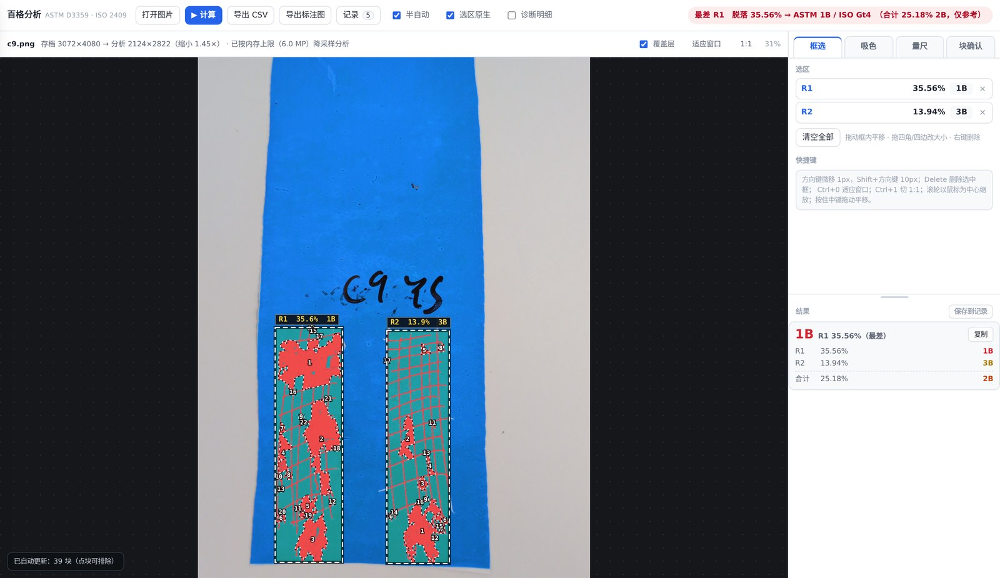
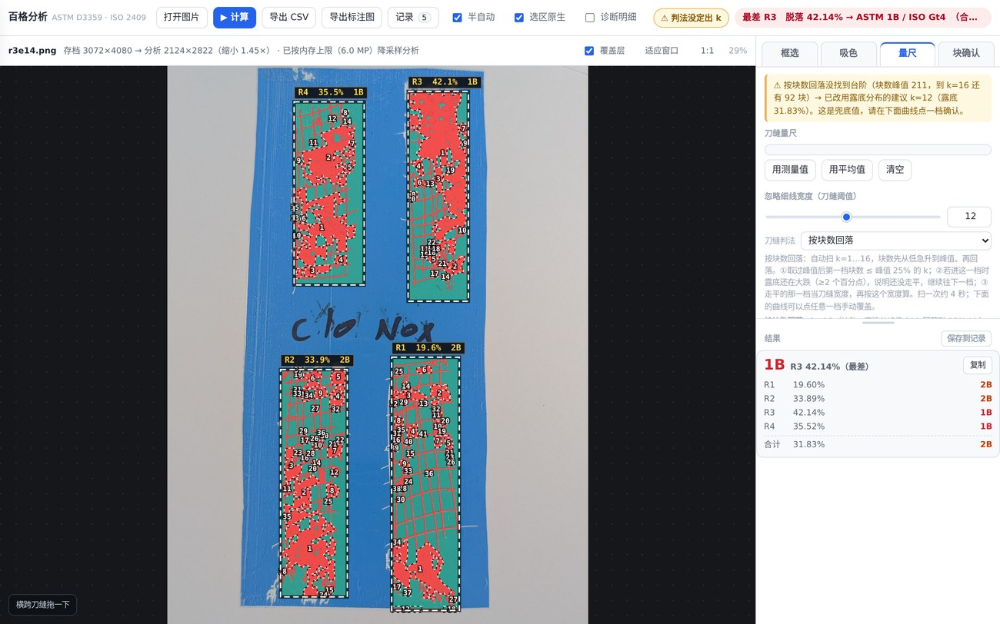
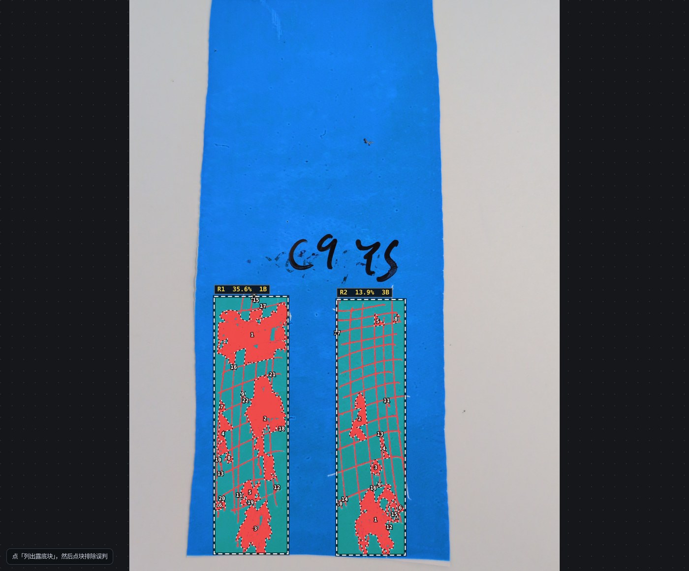
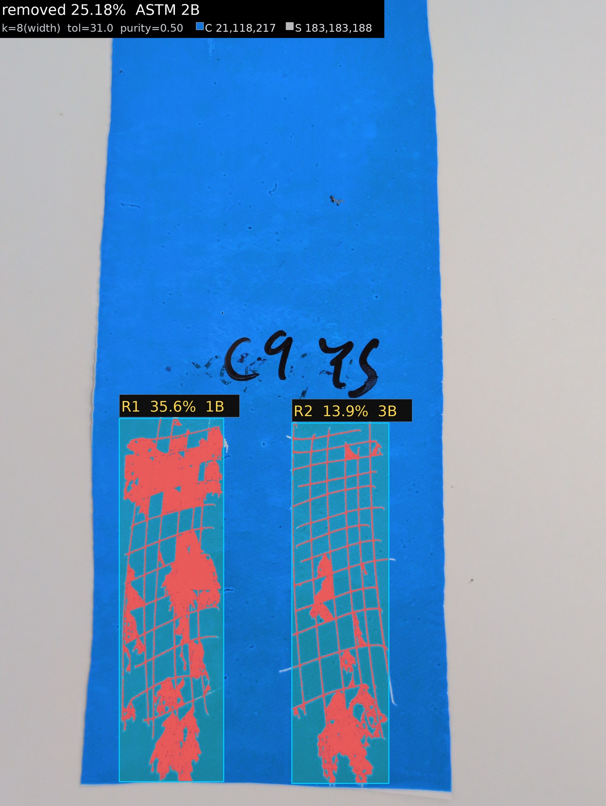

# 百格附着力图像分析工具（Cross-Cut Adhesion Analyzer）

把划格法（ASTM D3359 Method B / ISO 2409 / GB/T 9286）的附着力评级从目测比对变成可复算的数字：在照片上框出划格区、吸两个参考色，工具自动剔除刀缝，给出每个选区的脱落百分比与 ASTM / ISO 等级。

*本工具用 DeepSeek API 开发*（界面顶栏有标记）。



*多选区分析：每个选区各自给百分比与等级；结论按 ASTM 取最差区域，面积加权的合计仅供参考。*

## 它解决什么

人工判级靠比对标准图片，同一张样张不同人能差一档，而且「掉了多少」从来不是一个可以复查的数字。

这里把「涂膜掉了多少」变成面积比，随时可用同一张照片重算：

```
脱落百分比 = 剔除刀缝后的露底像素
            ─────────────────────────
            漆膜像素 + 原始露底像素
```

分子剔除刀缝（划痕沟槽本身就是裸基材，但不算涂层脱落），分母用原始露底，保证剔除动作不改变基准。

## 功能

- 多选区（ROI）：每处划格一个选区，按 ASTM 要求以**最差区域**给结论
- 颜色标定：CIELab 最近色分类 + 容差（未分类）+ 纯度（过渡带）两项独立控制
- 刀缝阈值 k：两种判法（按块数回落 / 按露底分布），可看 k=1…16 曲线并手挑
- 逐块确认：按连通域列出露底块，可逐块排除误判，结果实时重算
- 量尺：横跨刀缝测宽度，作为阈值来源之一
- 诊断明细：判定余量、露底厚度分布、容差敏感性、色差分布
- 记录：保存参数与结果，复开得到逐位相同的数字；可导出 CSV 与标注图
- 半自动：框完选区自动吸色 + 定阈值 + 出结果（结果仍需人工确认）

## 一次测量是怎么做出来的

1. **上传**：原图保留；分析在不超过 6 MP 的副本上做，开启「选区原生」时改为在选区内按原图像素分析。
2. **标定**：吸完好漆膜与露底基材两个参考色，像素转到 CIELab 后归给最近的那一色。距离超过**容差** → 未分类（两边都不算）；落在**纯度**带里的混色像素 → 过渡带。
3. **剔除刀缝**：`k×k` 形态学开运算——比 k 细的结构消失，比 k 厚的块保留。
4. **统计**：按上面的比值逐选区计算，再给面积加权合计。
5. **判级**：查 ASTM / ISO 表，报告的是最差选区的等级。

## 刀缝阈值 k 的两种判法



**按块数回落（默认）**：刀缝剔干净后，剩下的应该是少量大块。k 太小时刀缝连着脱落，掩膜被切成几百个碎片，所以块数曲线会「低 → 峰值 → 塌落」，塌落点就是缝宽。判据取峰值 25% 以内的第一档，然后在这之后只要每档露底还跌 ≥2 pp 就继续往下走，停在走平处。

**按露底分布**：厚度用逐层腐蚀测（≈2× 内切半径），分档 1-3 / 4-6 / 7-10 / 11-16 / ≥17 px。刀缝薄、脱落厚；薄结构（≤10 px）占露底一半以上时，取这一群的 75 分位 +2 当起点。这只是起点，随时可手改。

**两条判法都给不出答案时**（厚度连续、曲线没台阶）：回落到露底分布的建议值，但如果照这个 k 排完露底只剩原来 5% 以下（等于把真实脱落也删了）就拒绝给值；两种情况都在界面上留一条常驻警告，写明峰值、末档块数和实际在用的 k，不让一个沉默的数字悄悄跨过判级分界。

## 逐块确认



剔除后的露底按连通域编号（8 邻接，最小面积 30 px，最多 240 块）。误判成刀缝的段可以逐块排除，百分比、判级、存进记录的数一起跟着变。

## 导出



标注图带结论，以及复现它需要的全部参数（`k`、容差、纯度）和两个参考色块。

## 判级阈值

| 脱落面积 | ASTM | ISO / GB |
|---|---|---|
| ≤ 0.5%（视作 0） | 5B | Gt0 |
| > 0.5% 且 < 5% | 4B | Gt1 |
| 5% – 15% | 3B | Gt2 |
| 15% – 35% | 2B | Gt3 |
| 35% – 65% | 1B | Gt4 |
| > 65% | 0B | Gt5 |

## 怎么跑起来（不用敲命令）

**Windows**：双击 `start.bat`。
**Linux**：双击 `start.sh`（文件管理器若用编辑器打开它，右键 → 属性 → 允许作为程序执行），或命令行 `./start.sh`。
**macOS**：双击 `start.command`。

启动器支持中英双语（`start.bat --lang en` 可强制英文，默认跟随系统语言）。它会自动做这些事：在程序目录建 `.venv` 虚拟环境 → 装依赖（第一次 1~3 分钟，官方源失败自动换国内镜像）→ 起服务（默认 `127.0.0.1:8765`，被占就往后找）→ 打开浏览器。关掉窗口即停止。数据都留在代码旁边的 `data/` 目录里。

需要 Python 3.9+（Windows 安装时勾选 *Add python.exe to PATH*；Debian/Ubuntu 先 `sudo apt install python3 python3-venv`）。**不需要 tkinter**，桌面界面是可选的。

想手动起也可以：

```bash
python3 -m venv venv && ./venv/bin/pip install -r requirements.txt
./venv/bin/uvicorn server:app --host 127.0.0.1 --port 8765
```

服务只监听本机回环、自身不做登录；要远程访问请放在反代/SSO 后面。

## 目录

```
server.py      FastAPI 服务端：上传、分析、判法、记录、导出
crosscut.py    图像算法核心：颜色分类、开运算、厚度、连通域、判级
static/        前端（纯 HTML + JS，无构建步骤）
launcher.py    一键启动器（建 venv、装依赖、起服务、开浏览器）
start.bat      Windows 双击入口
start.sh       Linux 双击入口（macOS 用 start.command）
docs/          截图与技术说明
data/          运行期数据（上传会话、标注缓存、记录），首次运行自动创建——不入库
releases/      历史快照，回滚用——不入库
```

## 已知局限

- 开运算只看厚度不看形状：薄而大的团状脱落会被误删；
- 刀缝与脱落宽度连续分布时（无台阶）自动判法给不出确定值，此时给兜底值 + 显著警告 + 可点选的 k 曲线，由人决定；
- 颜色标定决定下限：白平衡/反光/阴影会影响分类，必要时多吸样色或调容差；
- 面积加权合计不是 ASTM 结论，看最差区域；
- 徒手用单刃刀划的格不构成合规试样，结果只能用于相对比较。

## 排错

- **Windows 报 `'65001' 不是内部或外部命令`**：`.bat` 被存成了 Unix 换行。`cmd.exe` 要求 **CRLF + 纯 ASCII**；请从当前 `master` 重新下载（已修，且 `.gitattributes` 已把 `*.bat` 钉成 CRLF）。
- **提示找不到 python**：重装 Python 时勾选 *Add python.exe to PATH*，或直接跑 `py -3 launcher.py`。
- **端口被占用**：启动器会自动往后找；也可 `--port 9000` 指定。

## 许可

**AGPL-3.0-or-later** —— 免费使用、修改、自建，公司内部用也没问题。若把改过的版本作为网络服务
对外提供，AGPL §13 要求你向这些用户开放对应源码。依赖及其许可见 `THIRD_PARTY_NOTICES.md`。

需要闭源修改、集成进产品对外销售、白牌、或要质保/SLA？可另购**商业授权**，见
`COMMERCIAL.md`（在 Issues 里开一个标题以 `[commercial]` 开头的 issue 即可）。

**「百格分析 / Baige」名称与图标不在授权范围内**，fork 和二次发布请换成你自己的名字。

Copyright (C) 2026 iamsad3508。本工具是计量辅助工具，不是认证测试方法，判级责任在检测人。

## 文档

`docs/technical-notes-v2.02.pdf` —— 安装部署（含双击启动器）、完整算法、判法规则与局限（14 页）。

---

[English](README.md)
